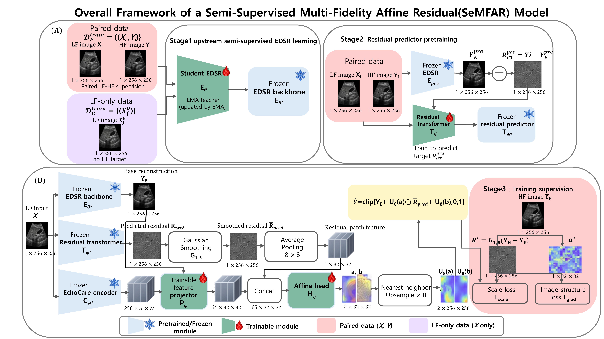
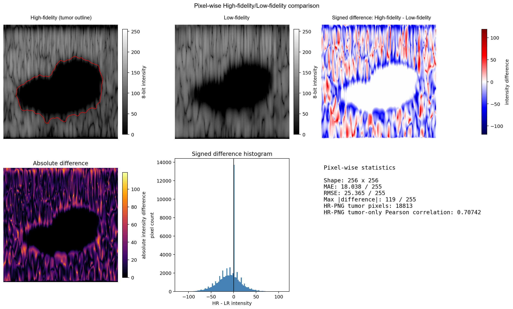

# SeMFAR: Semi-Supervised Multi-Fidelity Learning for Accelerating High-Fidelity B-mode Ultrasound Simulation

This repository provides a reproducible workflow for generating matched high-fidelity (HR) and low-fidelity (LR) B-mode ultrasound pairs with k-Wave, preparing paired/unpaired datasets, and training the EMA and SeMFAR models.

> The detailed, executable reproduction instructions below are retained from the original README. This introductory layout adds an overview and visual examples without replacing the established commands, paths, or caveats.

## Overview

SeMFAR uses matched multi-fidelity ultrasound simulations: a high-fidelity acquisition provides the target signal, while a lower-fidelity acquisition supplies the computationally cheaper input. Part 1 creates the simulation data; Part 2 prepares the training layout and runs GPU training.



## Pixel-wise high-/low-fidelity example

The following example shows the HR/LR image comparison and the signed/absolute pixel-wise difference used to inspect a generated pair.



## Repository structure

```text
1_Data_Generation/             # source-mask selection, k-Wave HR/LR generation, post-processing
2_Model_Training_SeMFAR/       # paired/unpaired preparation, EMA and SeMFAR GPU training
assets/                        # README figures
```

## End-to-end reproduction guide

This repository follows one path:

```text
source ultrasound image + tumor mask
  -> Part 1: matched HR/LR k-Wave generation and final DB40/diff120 processing
  -> Part 2: flat Paired/Unpaired training data and fixed split
  -> GPU training: EMA and SeMFAR
```

Read this file in order. Part-specific implementation details are in
`1_Data_Generation/README.md` and `2_Model_Training_SeMFAR/README.md`.

## 0. Environment and GPU check

Use one Python environment for both parts. On Windows with an RTX 5090:

```powershell
python -m pip install --upgrade torch torchvision torchaudio --index-url https://download.pytorch.org/whl/cu128
python -m pip install -r .\1_Data_Generation\requirements.txt
python -m pip install -r .\2_Model_Training_SeMFAR\requirements.txt
```

Verify a CUDA kernel, not merely GPU detection:

```powershell
python -c "import torch; x=torch.ones(1,device='cuda'); print(torch.__version__,torch.version.cuda,torch.cuda.get_device_name(0),(x+1).item())"
```

The final value must be `2.0` with no compute-capability error. RTX 5090 needs
CUDA 12.8-or-newer PyTorch. W&B is optional; use `--no-wandb`, or install it
with `python -m pip install wandb` and run `wandb login`.

## 1. Download and assemble source data

Download raw images/masks yourself; they are intentionally not in this
repository.

- BUSI: [Cairo University BUSI page](https://scholar.cu.edu.eg/?q=afahmy/pages/dataset)
- Extended IDs: [Zenodo images.zip](https://zenodo.org/records/18449815)

For the exact data10 subset, select and SHA-256-verify the 1,038 source masks:

```powershell
cd .\1_Data_Generation
python prepare_data10_masks.py `
  --busi-root "D:\datasets\Dataset_BUSI_with_GT" `
  --zenodo-root "D:\datasets\phyusnet_images\images_prepare2" `
  --output-root "D:\semfar_source\data10_masks" `
  --dry-run
```

Remove `--dry-run` only when `missing` and `hash_mismatch` are empty. The
selector handles masks only. Every selected `category (N)_mask.png` must have
the matching original `category (N).png` before simulation.

Expected input layout:

```text
D:\datasets\Dataset_BUSI_with_GT\
├── benign\benign (N).png
├── benign\benign (N)_mask.png
├── malignant\...
└── normal\...
```

## 2. Generate matched HR/LR pairs (Part 1)

This command preprocesses input image/mask pairs, runs GPU k-Wave for HR and
HR-derived LR with matched seed metadata, applies final post-processing, and
writes HR/LR PNG, PKL, and a pixel-wise comparison image.

```powershell
cd .\1_Data_Generation
python generate_hr_lr_pairs.py `
  --busi-dataset-path "D:\datasets\Dataset_BUSI_with_GT" `
  --work-root "D:\semfar_generation" `
  --prepare-data `
  --sample-name benign_1 `
  --scale-mode all `
  --gpu `
  --no-wandb
```

This is the one-sample generation smoke test. The first `--prepare-data` scans
all available matched input pairs; omit it on later simulation-only runs after
`processed_phantoms` exists. For reproducible batches, use explicit names with
`--run-seed` or `--seed-map`.

Full training requires at least 50 complete HR/LR pairs plus any desired
remaining LR-only cases (the historical-sized path uses 50 paired + 988
unpaired). Part 1 hands off from:

```text
D:\semfar_generation\final_training_data_hr_derived_lr_shared_post_db40_gain_diff120\
├── sc1.0\scans\scan_benign_N_HR.png/.pkl
├── sc0.5\scans\scan_benign_N_LR.png/.pkl
└── scan_benign_N_HR_minus_LR_pixelwise.png
```

See `1_Data_Generation/README.md` for seed, source-mask, k-Wave, output, and
post-processing details.

## 3. Create training folders (Part 2)

Part 2 checks complete pairs, reapplies final independent DB40/fixed-gain
post-processing from PKL, flattens file locations, and creates a deterministic
30/10/10 split.

```powershell
cd ..\2_Model_Training_SeMFAR
python prepare_training_data.py `
  --generation-root "D:\semfar_generation" `
  --part1-root "D:\path\to\SeMFAR_Github\1_Data_Generation" `
  --output-root "D:\semfar_training_data" `
  --paired-count 50 `
  --unpaired-count 0 `
  --selection-seed 2026 `
  --postprocess-mode final-db40
```

Output is `Paired/`, `Unpaired/`, `split.json`, and `dataset_manifest.json`.
`--unpaired-count 0` uses every complete LR sample left after paired selection.

## 4. GPU training (Part 2)

Run one seed/one epoch before a long experiment:

```powershell
python run_experiments.py `
  --data-root "D:\semfar_training_data" `
  --output-root "D:\semfar_runs\smoke_1epoch" `
  --seeds 42 `
  --epochs 1 `
  --batch-size 8
```

This runs EMA, then SeMFAR's internal upstream EDSR, residual predictor, and
affine head with frozen EchoCare. The upstream EDSR is not reported as a
standalone Fully Supervised model.

For the three-seed 300-epoch study:

```powershell
python run_experiments.py `
  --data-root "D:\semfar_training_data" `
  --output-root "D:\semfar_runs\final_300epoch" `
  --seeds 42 123 456 `
  --epochs 300 `
  --batch-size 8
```

PFT is not rerun because its exact original training implementation/checkpoint
is unavailable. Historical Table 3 files remain under `05_Table3_Evaluation`.
See `2_Model_Training_SeMFAR/README.md` for detailed transforms, splits,
frozen dependencies, and output interpretation.

## Smoke-test status

On the maintained Windows environment, CUDA 12.8 PyTorch was verified on an
RTX 5090. EMA and the full SeMFAR chain (upstream EDSR -> residual predictor
-> affine head) each completed a GPU one-epoch smoke test on an isolated
50-pair/50-unpaired subset. These are functional checks, not performance
results.

Do not commit downloaded source data, generated scans, W&B logs, or large
checkpoints to ordinary Git. Use the manifest/preparation scripts for source
reproduction and Git LFS only for intentionally retained weights.


